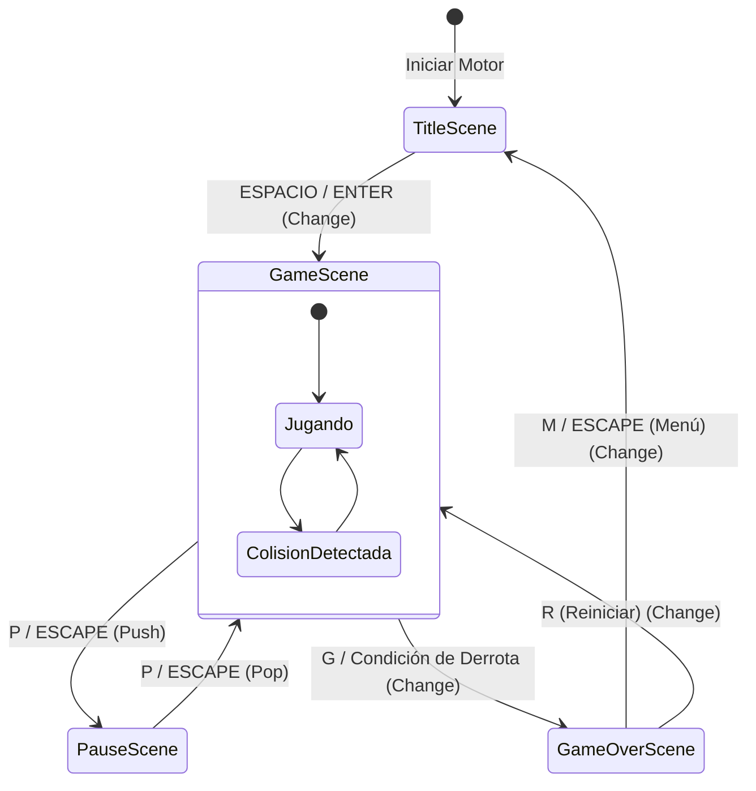
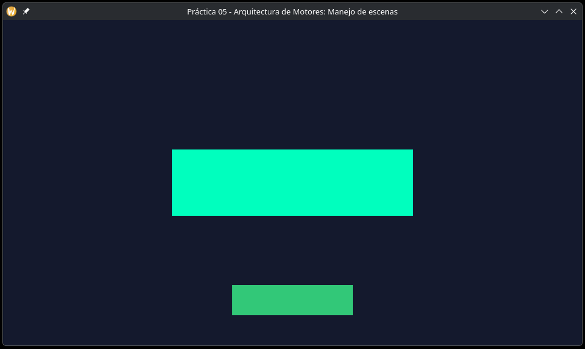
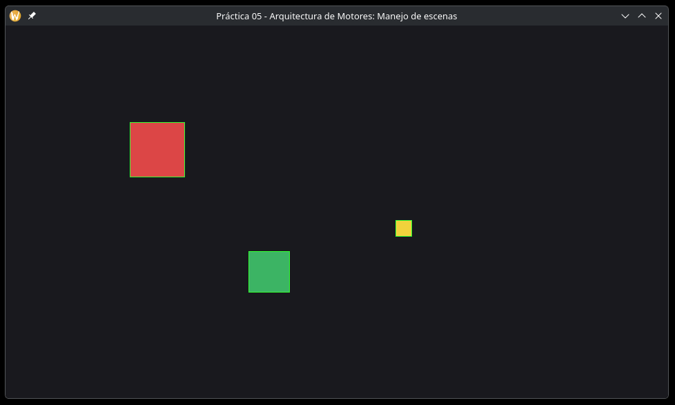
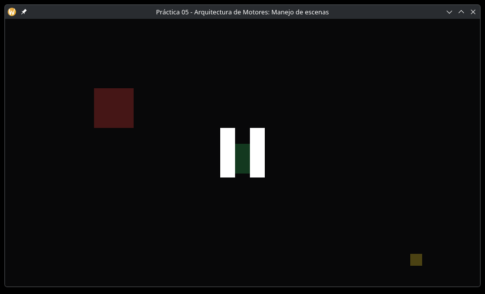
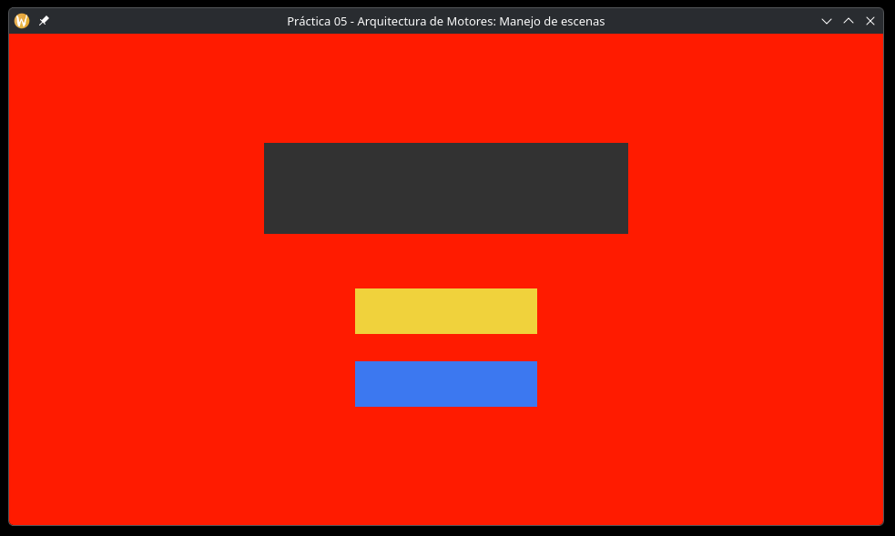

# Reporte Práctica 05 - Arquitectura de Motores: Manejo de escenas

**Nombre completo:** Luis Mario Solares Ramos

**Usuario de GitHub:** lmSolares

**Tag de entrega:** `v0.5`

**Enlace al Tag:** https://github.com/lmSolares/practica02-motor/releases/tag/v0.5

### Ventajas Arquitectonicas
Desacoplar las escenas en clases que heredan de una clase base Scene, nos permite encapsular la lógica, las variables y las entidades de cada pantalla en su propio archivo independiente (por ejemplo GameScene, TitleScene, etc.). Esto es mucho mejor que usar un switch con variables globales en el main.cpp, ya que quitamos el alto acoplamiento, haciendo que las variables se mezclen, haciendo más facil agregar o quitar nuevas pantallas sin tener que modificar y recompilar el bucle principal del motor.

### Destrucción de escenas inmediata
Si destruimos una escena inmediatamente desde su propio método, la memoria que ocupa la escena se libera. Peroo el programa aún necesita terminar de ejecutar ese método para regresar al bucle principal, si intentamos hacerlo, el programa intenta acceder a memoria que ya fue liberada, entonces en ese espacio puede hacer cualquier cosa, lo que traeria muchos problemas.

### Pila de escenas
Cuando queremos cambiar de escena podríamos solamente quitar la escena actual con Exit(), pero la idea no es esa, sino que, por ejemplo, cuando se pausa el juego se mantenga la partida actual. Entonces para eso es la pila: lo que se hace es que la nueva escena se apila encima de las escenas existentes. En el momento que se hace eso, en la siguiente iteración cuando se actualiza y se renderiza, se toma la escena más arriba en la pila (la escena que agregamos recientemente). Esto mantiene la escena que teníamos antes "congelada" como la penúltima escena en la pila. Cuando salgamos de la última escena que agregamos (PopScene() / Exit()), esta se desapila y la escena que queda arriba en la pila es la que teníamos anteriormente, por lo que en la siguiente iteración el juego retoma su flujo exactamente donde se quedó.

### Diagrama de flujo

### Capturas de pantalla

**Menu**

**Escena de juego**

**Pausa**

**Escena de GameOver**

