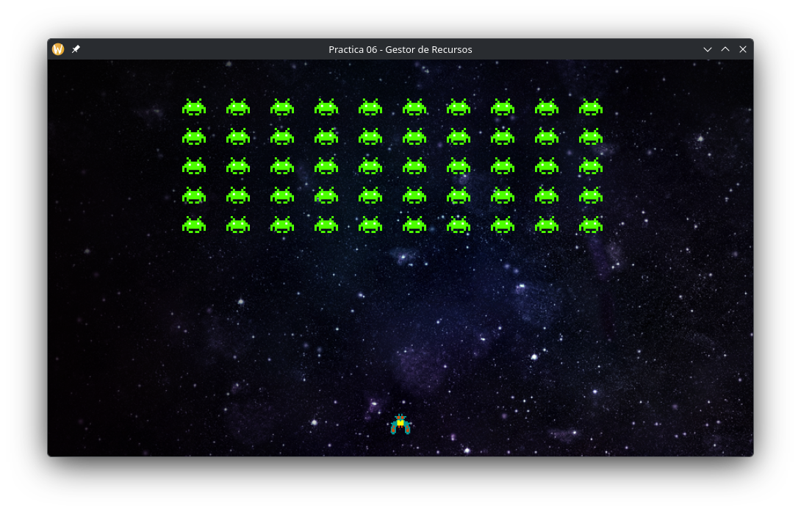
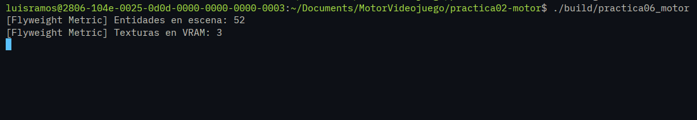
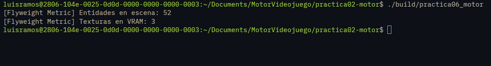

# Reporte: Práctica 06 - Gestión de Recursos, Patrón Flyweight y Fugas de Memoria

**Nombre:** Luis Mario Solares Ramos
**Repositorio y Tag (v0.6):** https://github.com/lmSolares/practica02-motor/releases/tag/v0.6

---

## 1. Explicación del Patrón Flyweight

El Patrón Flyweight es un patrón de diseño que permite optimizar el uso de la memoria compartiendo tanta información como sea posible entre objetos similares. En nuestro motor, lo hemos implementado dividiendo el estado de las entidades en dos categorías:

- **Estado Intrínseco (Compartido):** Es la textura de la imagen (`SDL_Texture`) alojada en la memoria de video. El `ResourceManager` gestiona este estado inmutable decodificando el archivo una sola vez y guardándolo en un diccionario (caché) para compartir su puntero con cualquier entidad que lo solicite.
- **Estado Extrínseco (Único):** Son los datos específicos de cada instancia en escena, gestionados por componentes como `TransformComponent` (posición, rotación, escala) y `SpriteComponent` (tinte, transparencia). Estos datos cambian por entidad sin modificar la textura base.

**¿Por qué evita la duplicación en VRAM?**
Porque en lugar de que 50 entidades asignen 50 bloques de memoria en la tarjeta gráfica para el mismo PNG, las 50 instancias almacenan un puntero que observa a una única textura compartida y gestionada por el `ResourceManager`.

---

## 2. Ciclo de Vida de la Imagen

Para cargar una imagen en SDL3 se necesita:

1.  **Decodificación a RAM (`SDL_Surface`):** Usamos `IMG_Load` para leer los bytes comprimidos del disco y decodificarlos en una matriz de píxeles (`SDL_Surface`) accesible directamente por el procesador en la memoria RAM principal.
2.  **Transferencia a VRAM (`SDL_Texture`):** La CPU no está optimizada para dibujar gráficos a 60 FPS. `SDL_CreateTextureFromSurface` envía estos píxeles hacia la memoria de video (VRAM) de la tarjeta gráfica.

**Consecuencias de omitir `SDL_DestroySurface`:**
Si no destruimos el `SDL_Surface` después de transferirlo a la GPU, los píxeles descomprimidos quedarán "flotando" permanentemente en el heap de la CPU. Al cargar múltiples recursos o reiniciar escenas, esta memoria desperdiciada se acumulará, provocando una fuga de memoria que AddressSanitizer reportará.

---

## 3. Análisis de AddressSanitizer (ASan)

Al presionar la tecla `L` en la escena de demostración, se provocó una fuga de memoria al cargar superficies sin liberarlas. Al cerrar el programa, AddressSanitizer interceptó el error y generó el siguiente reporte:

```text
=================================================================
==29012==ERROR: LeakSanitizer: detected memory leaks

Direct leak of 14800 byte(s) in 50 object(s) allocated from:
    #0 0x7f2aaaeef41f in malloc (/lib64/libasan.so.8+0xef41f)
    #1 0x7f2aaab3659b in SDL_CreateSurface_REAL (/lib64/libSDL3.so.0+0x13659b)
    #2 0x7f2aab58695a in LIBPNG_LoadPNG_IO_Internal.lto_priv.0 (/lib64/libSDL3_image.so.0+0x2c95a)
    #3 0x7f2aab56f627 in IMG_LoadPNG_IO (/lib64/libSDL3_image.so.0+0x15627)
    #4 0x7f2aab5631a6 in IMG_LoadTyped_IO (/lib64/libSDL3_image.so.0+0x91a6)
    #5 0x0000004048f2 in ResourceDemoScene::TriggerDeliberateLeak() /home/luisramos/Documents/MotorVideojuego/practica02-motor/src/practicas/ResourceDemoScene.cpp:92
    ...
```

**Interpretación de la traza:**
Como se puede observar en la línea que inicia con `#5`, AddressSanitizer identifica exactamente el archivo (`ResourceDemoScene.cpp`) y la línea exacta (`92`) dentro de la función `TriggerDeliberateLeak()` donde ocurrió la reserva de memoria con `IMG_Load` que jamás fue liberada, resultando en una pérdida de memoria directa por los objetos no destruidos.

---

## 4. Capturas de Pantalla y Evidencias

### A. Escena compartiendo texturas

_(Escena con el jugador, el fondo y los enemigos)_


### B. Métricas de Flyweight en Terminal

_(Salida comprobando 52 entidades vs 3 texturas en VRAM)_


### C. Cierre Limpio sin fugas de memoria

_(Salida de la terminal al cerrar el programa)_

