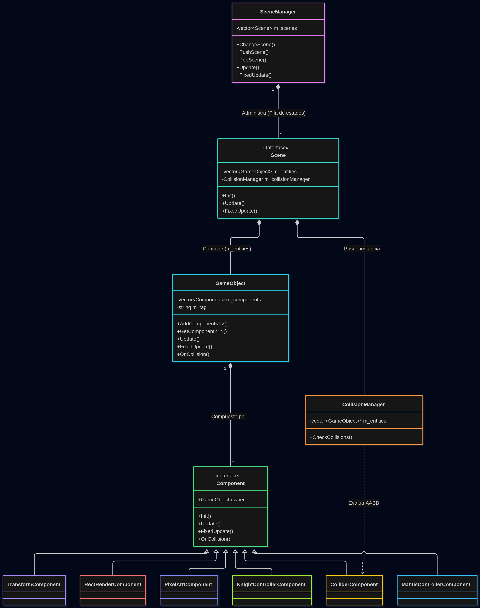
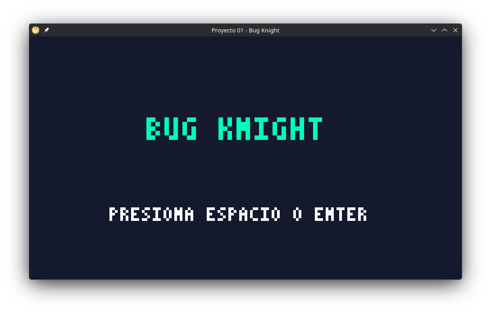
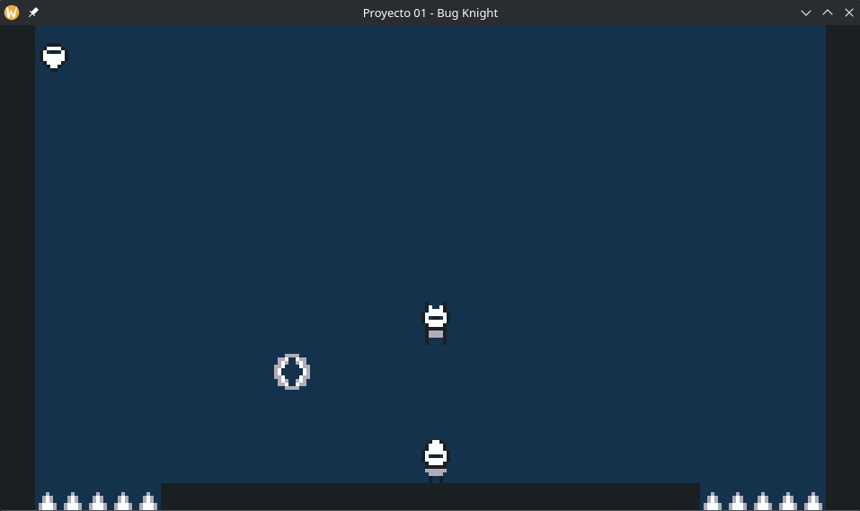
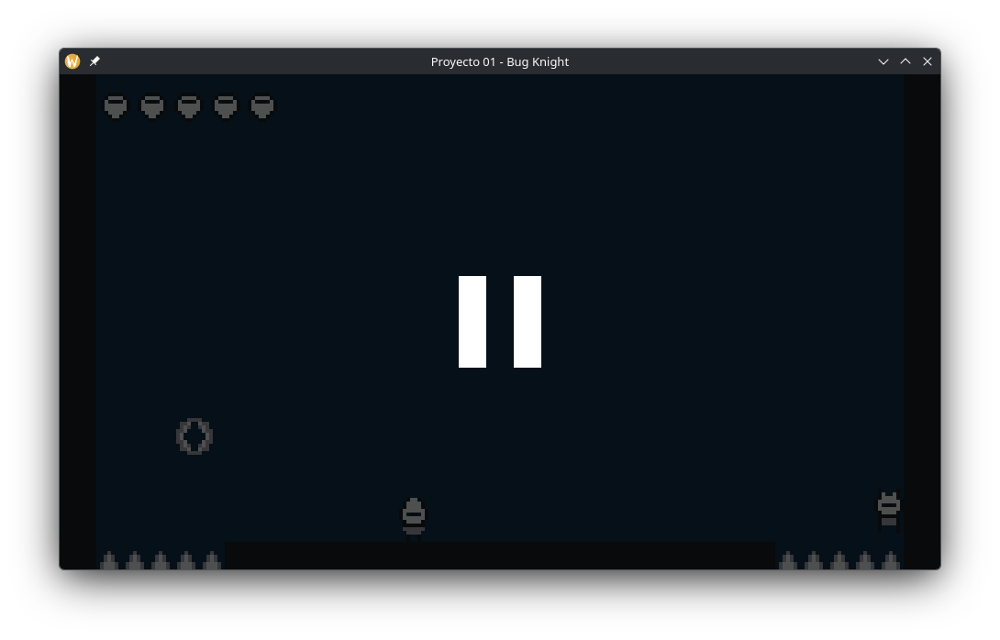
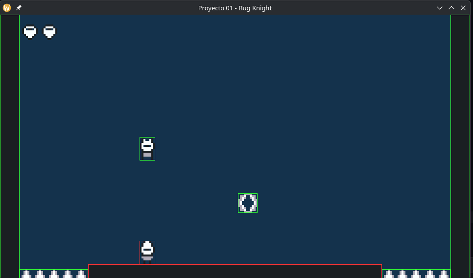
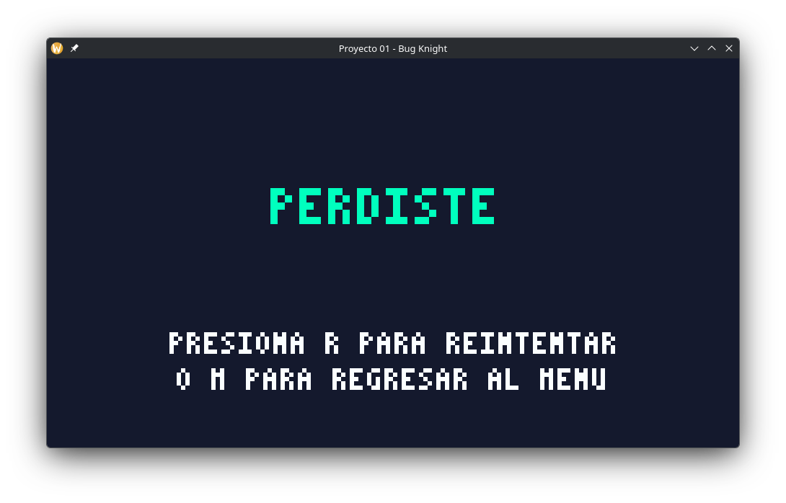

# Reporte Proyecto 01: Juego Arcade 2D con Primitivas

**Nombre completo:** Luis Mario Solares Ramos

**Usuario de GitHub:** lmSolares

**Tag de entrega:** `v1.0-checkpoint1`

**Enlace al Tag:** https://github.com/lmSolares/practica02-motor/releases/tag/v1.0-checkpoint1

### Descripción del Juego: "Bug Knight"

"Bug Knight" es un videojuego arcade estilo _Boss Rush_ inspirado en las mecánicas de Hollow Knight. El jugador controla a un pequeño caballero que debe sobrevivir y derrotar a una Mantis Lord dentro de una arena cerrada.

- **Controles:** Movimiento lateral con las Flechas direccionales, Salto con `Z`, Ataque con el Aguijón usando `X` y evasión (Dash) direccional con `C`.
- **Mecánicas y Victoria:** La Mantis Lord posee una inteligencia artificial basada en estados y cuenta con tres ataques principales: embestida por el suelo, ataque en caída libre y el lanzamiento de un proyectil autónomo (Boomerang). El jugador alcanza la victoria al lograr impactar a la Mantis con su Aguijón hasta reducir a cero sus 20 puntos de vida.
- **Derrota:** El jugador pierde la partida si agota sus 5 máscaras de vida al recibir daño por contacto con la Mantis, ser alcanzado por el Boomerang, o al caer en las trampas de pinchos (Spikes) ubicadas en los costados del suelo.

### Justificación Técnica

**Separación Modular Estricta (include/ y src/):**
Se abandonó el modelo de cabeceras únicas para adoptar una arquitectura estándar en C++. Las declaraciones de clases, firmas de métodos y variables se encuentran en los archivos de cabecera `.hpp` dentro del directorio `include/`, mientras que la lógica se aísla en los `.cpp` dentro de `src/`. Esta separación, apoyada por declaraciones adelantadas (_forward declarations_), elimina las dependencias circulares entre el `SceneManager` y las escenas individuales, reduce los tiempos de compilación del proyecto y oculta los detalles de implementación de las interfaces públicas.

**Desacoplamiento de la simulación física (Update vs FixedUpdate):**
Para garantizar un comportamiento físico determinista, se aplicó la técnica de simulación a paso fijo. La captura de eventos (teclado) y los temporizadores generales se actualizan en el método `Update(dt)`, el cual está atado a la tasa de fotogramas variable del monitor. Por el contrario, toda la cinemática de los actores, la aplicación de gravedad y la resolución de impactos mediante el `CollisionManager` se procesan exclusivamente en `FixedUpdate(fixed_dt)`. Al ejecutarse a una frecuencia inmutable de 60 Hz, los cálculos del `Vector2` se vuelven estables y predecibles, evitando que los objetos atraviesen paredes o que la física varíe dependiendo de la potencia del hardware.

### Diagrama de Arquitectura

### Capturas de Pantalla

**1. Pantalla de Inicio / Título**

**2. Partida Activa (Jugabilidad, HUD y Primitivas)**

**3. Menú de Pausa (Superpuesto en pantalla)**

**4. Depuración Visual (Debug Draw activo con F1)**

**5. Pantalla de Fin de Partida (Victoria / Derrota)**

